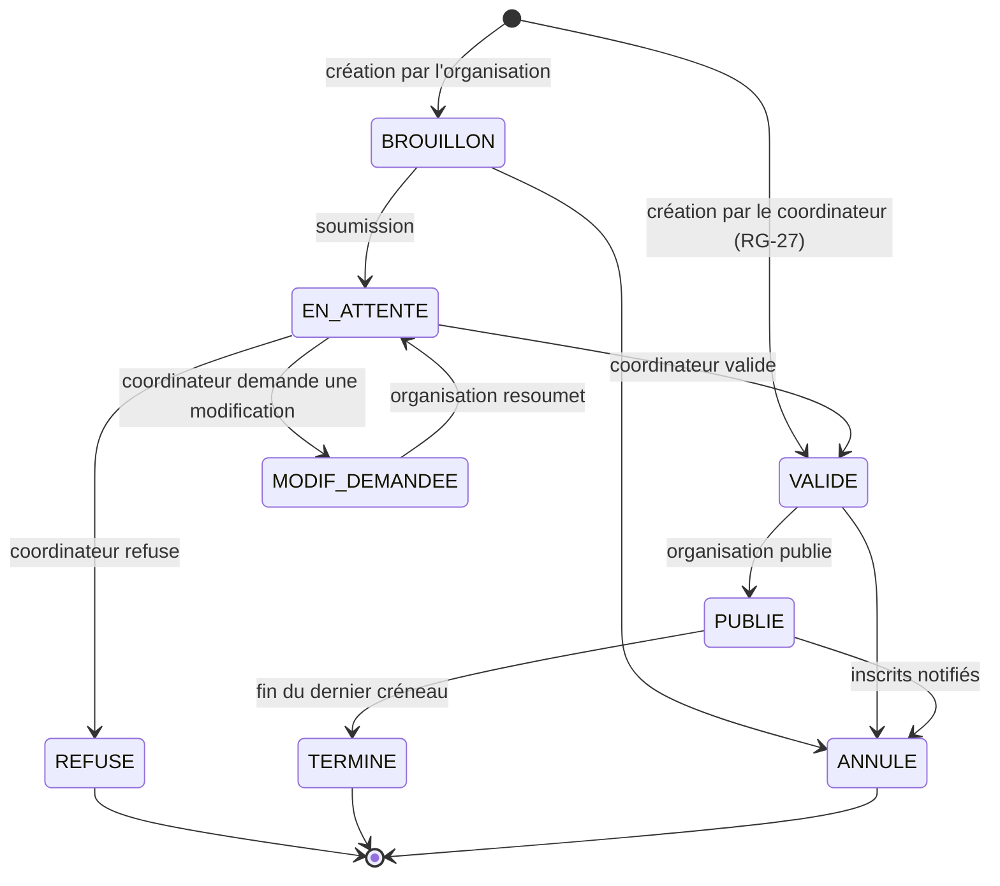
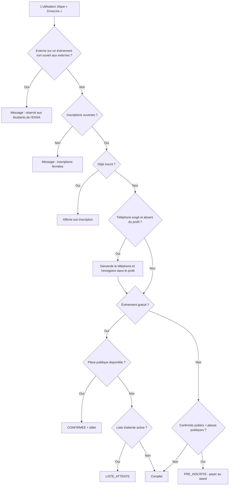

# 03 — Spécification des fonctionnalités

> Ce document détaille le **comportement** des fonctionnalités listées dans [02_Besoins.md](02_Besoins.md).

---

## 1. Catalogue par module

| Module | Fonctionnalités | V1 | V2 | V3 |
| --- | --- | :-: | :-: | :-: |
| **Comptes** | Connexion avec Google (compte étudiant pour `@etu.uae.ac.ma`, compte externe pour les autres adresses), profil (téléphone, niveau) | ✅ | | |
| | Création de comptes par le staff (toute adresse Google) | ✅ | | |
| | Membres d'organisation et rôles | | ✅ | |
| **Organisations** | Page publique, édition du profil | ✅ | | |
| | Favoris, notifications | | ✅ | |
| **Événements** | Demande (simple / programme), créneaux multi-lieux | ✅ | | |
| | Collaboration entre organisations (partenaires ajoutés directement) | ✅ | | |
| | Validation par le coordinateur | ✅ | | |
| | Publication : affiche, description, planning, tarifs par catégorie, ouverture aux externes, capacité, places membres, téléphone requis | ✅ | | |
| | Annonces aux inscrits | | ✅ | |
| **Inscriptions** | En ligne, au stand (QR dynamique), liste d'attente | ✅ | | |
| | Recherche par nom et marquage du paiement | ✅ | | |
| | Attribution des places membres | ✅ | | |
| | Billet QR, check-in par jour | ✅ | | |
| | Export Excel | ✅ | | |
| | Export agenda (.ics) | | ✅ | |
| **Coordination** | Demandes en attente, calendrier global, lieux | ✅ | | |
| | Création d'événements pour une organisation | ✅ | | |
| | Statistiques de participation | ✅ | | |
| | Périodes bloquées | | ✅ | |
| **Trésorerie** | Recettes, dépenses, justificatifs, solde (privé) | | ✅ | |
| **Après l'événement** | Feedback, attestations | | | ✅ |

---

## 2. Cycle de vie d'un événement

| Statut | Modifiable par l'organisation | Visible des étudiants |
| --- | --- | --- |
| `BROUILLON` | Tout | Non |
| `EN_ATTENTE` | Rien (en lecture seule pendant l'examen) | Non |
| `MODIF_DEMANDEE` | Tout | Non |
| `VALIDE` | Détails seulement ; créneaux et lieux verrouillés (RG-08) | Non |
| `PUBLIE` | Détails seulement | Oui |
| `REFUSE` / `ANNULE` / `TERMINE` | Rien | `TERMINE` : oui, dans l'historique |

---

## 3. Créer une demande d'événement

**Acteur :** organisation principale.

1. L'organisation choisit la **structure** :
   - **Événement simple** : par exemple, une conférence d'un jour ou une formation sur 3 jours avec une seule inscription.
   - **Programme** : par exemple, une semaine culturelle qui contient un tournoi, un atelier et une soirée, chacun avec sa propre inscription.
2. Elle saisit le titre, la catégorie et une description courte.
3. Elle ajoute les **créneaux** : date, heure de début, heure de fin, puis un ou plusieurs lieux.
   - Lieux disponibles : salles `001`–`006`, `101`–`106`, `201`–`206`, Amphi, Salle de lecture, Toute l'école, Autre (avec précision).
   - Pour un programme, les créneaux sont saisis **dans chaque sous-événement**.
4. Elle peut ajouter des **organisations partenaires** (collaboration). L'ajout est **direct** : pas d'invitation ni d'acceptation, car les clubs se mettent d'accord en amont. Les partenaires sont simplement informés par email (RG-04).
5. Elle soumet la demande : le statut passe à `EN_ATTENTE` et le coordinateur est notifié par email.

**Aide au coordinateur** : sur la fiche de la demande, une section « Le même jour » liste les autres événements validés ou publiés aux mêmes dates, avec leurs lieux. Elle **ne bloque rien** (RG-10).

---

## 4. Validation par le coordinateur

1. Le coordinateur ouvre la liste des demandes `EN_ATTENTE`, triées par date de soumission.
2. Il consulte la demande et la section « Le même jour ».
3. Il décide :
   - **Valider** : l'organisation est notifiée et peut compléter puis publier.
   - **Demander une modification** (commentaire obligatoire) : l'organisation corrige et resoumet.
   - **Refuser** (commentaire obligatoire) : la demande est close.
4. Chaque décision est historisée dans `DECISION`.

Pour un **programme**, la décision s'applique au parent et à tous ses sous-événements.

Si un changement de date est nécessaire **après validation**, l'organisation contacte le coordinateur, qui modifie lui-même les créneaux (RG-08).

### 4.1 Événement créé par le coordinateur (RG-27)

1. Le coordinateur choisit l'**organisation principale** (et éventuellement des partenaires), puis saisit la structure, les créneaux et les lieux, comme dans l'assistant de l'organisation.
2. L'événement est créé directement en `VALIDE`. Une décision « Créé par le coordinateur » est enregistrée dans l'historique.
3. L'organisation principale le retrouve dans son espace. Elle **ou** le coordinateur complète les détails et publie.

---

## 5. Publication

Après validation, l'organisation complète :

| Champ | Obligatoire pour publier |
| --- | --- |
| Description complète | Oui |
| Affiche principale | Oui |
| Planning (une ou plusieurs photos, éventuellement par jour) | Non |
| Tarifs : **gratuit**, ou une **liste de tarifs** (adhérent, non-adhérent, externe proposés par défaut), chacun **affiché ou non** (RG-36) | Oui |
| **Ouvert aux externes** (personnes hors ENSA) | Non (désactivé par défaut) |
| Capacité (vide = illimitée) | Non |
| Mode d'inscription : `STAND` ou `EN_LIGNE` | Oui |
| Liste d'attente (événements gratuits seulement) | Non |
| **Places réservées aux membres** (≤ capacité) | Non (0 par défaut) |
| **Numéro de téléphone obligatoire** | Non (désactivé par défaut) |

Pour un **programme**, on publie le parent, et chaque sous-événement a ses propres tarifs, son ouverture aux externes, sa capacité, ses places membres et son mode d'inscription.

**Affichage public des tarifs** : la carte d'un événement indique « Gratuit » ou « dès X DH » (le plus bas des tarifs affichés). La fiche liste les **tarifs affichés** et précise que le tarif est appliqué par le club au moment du paiement. Les tarifs non affichés (« Bureau »…) n'apparaissent jamais côté public.

Le public voit les **places publiques restantes** = capacité − places membres − confirmés publics (RG-29).

---

## 6. Inscriptions

### 6.1 Inscription en ligne (mode `EN_LIGNE`)

### 6.2 Inscription au stand (QR dynamique)

1. Un membre de l'organisation ouvre une **session stand** sur sa tablette ou son téléphone. Un grand QR code s'affiche et se renouvelle toutes les 30 s.
2. L'étudiant scanne le QR avec son téléphone et arrive sur la page d'inscription de l'événement. Il se connecte avec Google si besoin (le compte est créé automatiquement), puis saisit son téléphone si l'événement l'exige.
3. L'inscription est créée avec `source = STAND` :
   - événement gratuit : `CONFIRMEE` (s'il reste de la place) ;
   - événement payant : `PRE_INSCRITE`.
4. L'étudiant paie en espèces.
5. Le membre du stand retrouve l'étudiant en **cherchant son nom** (ou en scannant son billet), puis clique sur « Payé ». L'inscription passe à `CONFIRMEE` s'il reste une place publique (RG-13).

> Photographier le QR et le partager ne sert à rien : il expire au bout de 30 à 60 s.

### 6.3 Marquage du paiement

- **Cas typique** : un étudiant s'est pré-inscrit en ligne et vient payer au stand. Le club tape son nom dans la recherche (les pré-inscrits apparaissent en premier), encaisse, puis clique sur « Payé ». Le scan du billet est une alternative.
- Disponible dans les modes `STAND` et `EN_LIGNE`, que les inscriptions soient ouvertes ou fermées (RG-25).
- On enregistre le montant, la date et **l'organisation qui encaisse** (RG-18).
- Une **annulation du paiement** (en cas d'erreur de saisie) remet l'inscription en `PRE_INSCRITE`. Elle n'est possible que pour l'organisation qui a encaissé.
- Quand toutes les places publiques sont confirmées, le bouton « Payé » est désactivé et les pré-inscrits restants sont notifiés (RG-26).

### 6.3 bis Choix du tarif à l'encaissement (RG-32, RG-33)

- La plateforme ne sait pas qui est adhérent : dans la liste des inscrits et en mode caisse, le membre du stand **choisit le tarif** de chaque participant (« Adhérent · 30 DH », « Non-adhérent · 50 DH », « Bureau · 0 DH »…), puis clique « Payé ».
- Tous les tarifs sont proposés, **y compris les tarifs non affichés**.
- Un tarif à 0 DH confirme l'inscription sans encaissement.

### 6.4 Annulation (RG-17)

| Statut avant | Par l'étudiant | Par l'organisation |
| --- | --- | --- |
| `PRE_INSCRITE` | ✅ Annulée, sans impact | ✅ |
| `LISTE_ATTENTE` | ✅ Annulée, les positions suivantes avancent | ✅ |
| `CONFIRMEE` gratuite | ✅ Annulée, le premier en liste d'attente est promu et notifié | ✅ |
| `CONFIRMEE` **payée** | ❌ Message « Contactez l'organisation », avec ses coordonnées | ✅ Seulement l'organisation qui a encaissé ; la place est libérée, remboursement éventuel hors plateforme |

### 6.5 Places réservées aux membres (RG-29)

- À la publication, l'organisation indique un nombre de **places membres**. Ces places sont retirées du quota public dès le départ.
- Depuis la liste des inscrits, elle peut **attribuer** une place membre à un étudiant en le cherchant par nom ou par email (il doit s'être connecté au moins une fois sur la plateforme). L'inscription est créée directement en `CONFIRMEE`, `source = MEMBRE`, sans paiement, avec un billet.
- Une place membre non attribuée reste simplement réservée. Le compteur affiche par exemple « 12 / 15 places membres attribuées ».
- Pour rendre des places au public, l'organisation réduit le nombre de places membres (jamais en dessous du nombre déjà attribué).

---

## 7. Billet et check-in

- Chaque inscription `CONFIRMEE` a un **billet** : un QR code qui contient un jeton aléatoire (RG-20).
- Le billet affiche : le titre, les créneaux, les lieux, le nom de l'étudiant, le statut de paiement et les **coordonnées de l'organisation** (pour une demande d'annulation après paiement).
- **Check-in** :
  1. L'organisation ouvre l'écran « Contrôle d'entrée » et choisit le créneau du jour, présélectionné automatiquement.
  2. Elle scanne le billet. Le résultat s'affiche immédiatement : ✅ entrée valide / ⚠️ déjà scanné / ❌ non confirmé ou mauvais événement.
  3. Une présence est enregistrée **par créneau** : un événement de 3 jours donne 3 check-ins possibles.
- **Solution de repli** : une recherche par nom, si le téléphone de l'étudiant n'a plus de batterie.

---

## 8. Collaboration entre organisations

| Action | Principale | Partenaire |
| --- | :-: | :-: |
| Être ajouté à l'événement | — | Directement, sans acceptation |
| Modifier l'événement, ses créneaux, sa publication | ✅ | ❌ |
| Soumettre au coordinateur | ✅ | ❌ |
| Voir l'événement dans son espace et sur sa page publique | ✅ | ✅ |
| Voir la liste des inscrits | ✅ | ✅ |
| Ouvrir une session stand | ✅ | ✅ |
| Marquer un paiement (encaissé pour son compte) | ✅ | ✅ |
| Annuler une inscription payée | Si elle a encaissé | Si elle a encaissé |
| Attribuer des places membres (à ses propres membres) | ✅ | ✅ |
| Voir les montants encaissés **par les autres** organisations | ❌ | ❌ |
| Faire le check-in | ✅ | ✅ |

---

## 9. Trésorerie (V2)

- Accessible uniquement aux membres autorisés de l'organisation (trésorier, président).
- Saisie de **recettes et dépenses** : montant, libellé, catégorie, date, événement lié (facultatif) et justificatif (photo ou PDF).
- **Synthèse** : solde, total par événement, total par catégorie.
- **Recettes de billetterie** : la plateforme propose de créer automatiquement une recette à partir des paiements encaissés par l'organisation pour un événement.
- Le coordinateur, l'administrateur et les autres organisations n'y ont **aucun accès**, ni par l'interface ni par l'API (RG-21).

---

## 10. Matrice des permissions (V1)

| Action | Visiteur | Étudiant | Organisation | Coordinateur | Admin |
| --- | :-: | :-: | :-: | :-: | :-: |
| Voir les événements publiés | ✅ | ✅ | ✅ | ✅ | ✅ |
| S'inscrire à un événement | | ✅ | | | |
| Créer et soumettre une demande | | | ✅ | | |
| Créer un événement pour une organisation (directement validé) | | | | ✅ | |
| Compléter et publier un événement validé | | | ✅ (principale) | ✅ | |
| Valider ou refuser une demande | | | | ✅ | |
| Modifier les créneaux après validation | | | | ✅ | |
| Voir les inscrits d'un événement | | | ✅ (si organisatrice) | Nombre seulement | |
| Voir le téléphone des inscrits | | | ✅ si l'événement l'exige (RG-30) | | |
| Marquer un paiement / faire le check-in | | | ✅ (si organisatrice) | | |
| Gérer les organisations et les lieux | | | | ✅ | ✅ |
| Gérer tous les comptes | | | | | ✅ |
| Trésorerie (V2) | | | ✅ (la sienne) | ❌ | ❌ |

### Rôles dans une organisation (V2, BF-43)

Chaque membre se connecte avec **son propre compte Google** (étudiant ou externe déjà inscrit) ; le compte commun du club garde tous les droits.

| Action | Compte du club | Président·e | Trésorier·e | Membre |
| --- | :-: | :-: | :-: | :-: |
| Voir les événements de l'organisation | ✅ | ✅ | ✅ | ✅ |
| Inscrits, stand, encaissement, contrôle d'entrée | ✅ | ✅ | ✅ | ✅ |
| Demandes, publication, annonces, annulation, places membres, export des inscrits | ✅ | ✅ | | |
| Profil du club, gestion des membres | ✅ | ✅ | | |
| Trésorerie | ✅ | ✅ | ✅ | |

- Personne ne peut changer son propre rôle ni se retirer (évite de se couper l'accès) ; un membre retiré garde sa ligne (date de fin) pour l'historique.
- Une personne membre de plusieurs organisations choisit le club actif ; le serveur revérifie toujours l'appartenance.
- Coordinateur et administrateur ne peuvent pas être membres d'une organisation (RG-21).
