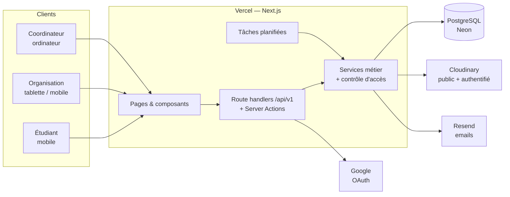
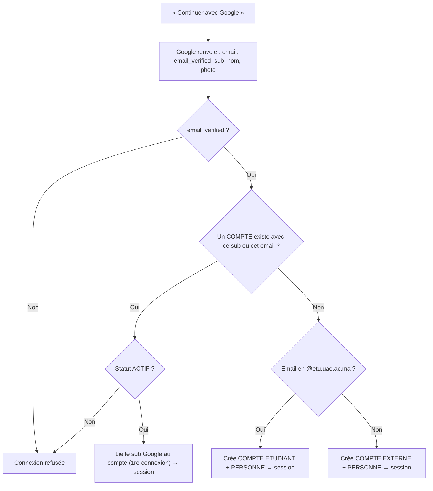

# 05 — Architecture technique

> **Statut :** stack **proposée, à confirmer** par l'équipe. Le modèle de données ([06](06_Database.md)) et l'API ([07](07_API.md)) restent valables avec une autre stack.

---

## 1. Stack proposée

| Couche | Choix | Raison |
| --- | --- | --- |
| Framework | **Next.js** (App Router) + **TypeScript** | Front et back dans un seul projet, très documenté, hébergement gratuit |
| Base de données | **PostgreSQL** hébergé sur **Neon** | Relationnel (adapté au MLD), offre gratuite, sauvegardes avec restauration à un instant donné |
| ORM | **Drizzle** | Schéma en TypeScript, migrations SQL lisibles |
| Authentification | **Better Auth** (ou Auth.js), fournisseur **Google** | Connexion Google uniquement, aucun mot de passe à gérer |
| Validation | **Zod** | Mêmes schémas côté formulaire et côté serveur |
| UI | **Tailwind CSS** + **shadcn/ui** | Composants accessibles, rapide à construire |
| Images | **Cloudinary** | Affiches et plannings redimensionnés automatiquement ; justificatifs en accès **authentifié** |
| Emails | **Resend** (ou SMTP de l'école) | Décisions du coordinateur, confirmations d'inscription, notifications aux inscrits |
| QR | `qrcode` (génération), `@zxing/browser` (scan dans le navigateur) | Fonctionne sans application native |
| Export | `exceljs` | Listes d'inscrits en .xlsx |
| Hébergement | **Vercel** + **Vercel Cron** | Déploiement à chaque push, environnements de prévisualisation |
| Mobile | **PWA** (manifest + service worker) | Installable sur l'écran d'accueil, notifications push (V2) |

---

## 2. Vue d'ensemble



**Règle d'or** : toute la logique métier et tous les contrôles d'accès sont dans `server/services`. Les pages, les Server Actions et les routes API ne font qu'appeler ces services. Aucune règle n'est vérifiée uniquement côté client.

---

## 3. Structure du projet

```
ensate-clubs/
├── docs/                       ← ce dossier
├── drizzle/                    migrations SQL générées
├── public/                     manifest PWA, icônes
├── src/
│   ├── app/
│   │   ├── (public)/           accueil, événements, organisations, stand
│   │   ├── (auth)/             connexion Google
│   │   ├── moi/                espace étudiant
│   │   ├── org/                espace organisation
│   │   ├── coord/              espace coordinateur
│   │   ├── admin/              espace admin
│   │   └── api/v1/             routes REST
│   ├── server/
│   │   ├── db/                 schema.ts, client, seed.ts (filières, lieux)
│   │   ├── auth/               configuration de l'authentification
│   │   ├── permissions/        requireRole, requireOrganisateur, requireFinance…
│   │   ├── services/           evenements, inscriptions, stand, checkin, finances…
│   │   └── emails/             gabarits d'emails
│   ├── components/             UI réutilisable
│   └── lib/                    utilitaires (dates, formatage DH, qr…)
└── tests/
    ├── unit/
    ├── integration/
    └── e2e/
```

---

## 4. Authentification

Connexion **uniquement avec Google** (OAuth 2.0 / OpenID Connect). La plateforme ne stocke **aucun mot de passe**.

### Déroulement d'une connexion (RG-01)



- On peut passer le paramètre Google `hd=etu.uae.ac.ma` comme **indication** dans l'écran de Google, mais le domaine est **toujours vérifié côté serveur**, sur l'email vérifié.
- Après la première connexion, le compte est reconnu par l'identifiant Google `sub`, qui reste stable même si l'adresse change.
- **Comptes créés par le staff** (organisations, coordinateur, étudiants en gmail) :
  - le staff saisit l'adresse ;
  - le compte s'active à la première connexion Google avec cette adresse ;
  - l'adresse **doit être un compte Google** (gmail.com ou Google Workspace). Un club dont l'adresse n'est pas chez Google doit créer une adresse gmail dédiée.
- La sécurité des comptes (mot de passe, double authentification) est gérée par Google. On recommande d'activer la **validation en deux étapes** sur les comptes Google des organisations et du coordinateur.
- Sessions par cookie `HttpOnly`, `Secure`, `SameSite=Lax`.
- **Configuration Google Cloud** : un client OAuth de type « Application Web » et un écran de consentement « Externe », limité aux scopes `openid email profile`. Ces scopes de base ne demandent pas de vérification approfondie par Google.
- **Tests automatisés** : un fournisseur de connexion factice est activé **uniquement** quand `NODE_ENV=test`. Il n'existe jamais en production.

> ⚠️ **À vérifier dès le début** : l'administrateur Google Workspace de l'université peut bloquer les applications tierces pour les comptes `@etu.uae.ac.ma`. Il faut tester la connexion avec un vrai compte étudiant avant d'aller plus loin.

---

## 5. Autorisation

Chaque service applique trois niveaux de contrôle :

1. **Rôle** : `requireRole(compte, 'COORDINATEUR')`.
2. **Périmètre** : l'organisation connectée est-elle organisatrice de **cet** événement ? Les identifiants envoyés par le client ne font jamais foi : on relit toujours la base.
3. **Règles spécifiques** : par exemple, seule l'organisation principale modifie l'événement (RG-04), et seule l'organisation qui a encaissé peut annuler un paiement.

### Confidentialité financière (RG-21)

- Le module `finances` a son propre garde `requireFinance(compte, organisationId)`, qui :
  - autorise **uniquement** le compte de l'organisation, ou un membre ayant le rôle `TRESORIER` ou `PRESIDENT` (en place : `requireOrganisation("finance")`) ;
  - **refuse explicitement** les rôles `COORDINATEUR` et `ADMIN` ;
  - est le seul point d'entrée des requêtes vers `TRANSACTION`.
- Pas de fonction « se connecter en tant que » pour l'admin, qui contournerait ce garde.
- Les statistiques du coordinateur sont calculées par des requêtes **qui ne sélectionnent aucune colonne de montant**.
- Justificatifs : envoyés sur Cloudinary en type `authenticated`, et accessibles seulement via une URL signée valable 5 minutes, générée après passage du garde.

> **Limite à connaître** : ces protections sont **applicatives**. Une personne qui a accès directement à la base de données (l'hébergeur, le développeur qui détient les identifiants Neon) peut techniquement lire ces données. Il existe une option plus forte, le **chiffrement côté navigateur** avec une clé connue du seul trésorier, mais elle complique fortement la solution : en cas de perte de la clé, les données sont perdues. Elle n'est pas prévue en V2. Mesure raisonnable : limiter strictement qui détient les identifiants de production.

---

## 6. Mécanismes clés

### 6.1 QR dynamique du stand (RG-15)

```
À l'ouverture de la session : secret = 32 octets aléatoires (stocké dans SESSION_STAND)
Fenêtre :  w = floor(maintenant / 30 s)
Jeton :    t = base64url(HMAC-SHA256(secret, w))[0..16]
QR :       https://<domaine>/stand/<id_session>?t=<t>
```

- Le serveur accepte les fenêtres `w` et `w-1`, si la session est active et non expirée.
- Si le jeton est valide, le serveur pose un **cookie signé « accès stand »** (15 minutes, lié à la session). L'étudiant a ainsi le temps de faire l'aller-retour de connexion Google, même si le QR a changé entre-temps.
- L'écran du stand interroge le serveur toutes les 30 s pour obtenir le nouveau jeton. Le secret ne quitte jamais le serveur.

### 6.2 Billet (RG-20)

- `token_billet` = 32 octets aléatoires en base64url, générés à la création de l'inscription.
- Le QR contient uniquement ce jeton. Le scan appelle l'API de check-in ou de paiement, qui vérifie que le billet appartient bien à un événement de l'organisation qui scanne.

### 6.3 Pas de surréservation (RG-13, BNF-03)

Marquer un paiement s'exécute dans **une transaction** :

```sql
BEGIN;
SELECT capacite, places_membres FROM evenement WHERE id_evenement = $1 FOR UPDATE;  -- verrou
SELECT count(*) FROM inscription
 WHERE id_evenement = $1 AND statut = 'CONFIRMEE' AND source <> 'MEMBRE';
-- si count < capacite - places_membres (ou capacite IS NULL) :
UPDATE inscription SET statut='CONFIRMEE', date_paiement=now(), montant_paye=$2,
       id_organisation_encaisse=$3 WHERE id_inscription=$4 AND statut='PRE_INSCRITE';
COMMIT;
```

Le même verrou s'applique aux inscriptions gratuites, à la promotion depuis la liste d'attente et à l'attribution des places membres (`count(source = 'MEMBRE') < places_membres`).

### 6.4 Tâches planifiées (Vercel Cron)

| Fréquence | Tâche |
| --- | --- |
| Chaque nuit (3 h UTC) | `PUBLIE` → `TERMINE` quand le dernier créneau est passé (plan gratuit Vercel : un cron par jour ; les listes masquent déjà les événements passés en temps réel) |
| Tous les jours à 18h | Rappel par email aux inscrits confirmés pour les événements du lendemain *(V2)* |
| Chaque nuit (même tâche) | Fermeture des sessions stand expirées (le jeton d'un stand expiré est de toute façon refusé immédiatement) |

---

## 7. Fichiers

| Type | Stockage | Accès |
| --- | --- | --- |
| Logo, affiche, planning, photo | Cloudinary `upload` (public) | Public |
| Justificatif financier (V2) | Cloudinary `authenticated` | URL signée après `requireFinance` |

- Envoi **signé** depuis le navigateur : le serveur fournit une signature, et le fichier ne transite pas par Vercel.
- Contrôles : type (jpg, png, webp, pdf), taille maximale (affiche 5 Mo, justificatif 10 Mo).

---

## 8. Environnements et déploiement

| Environnement | Base | Usage |
| --- | --- | --- |
| Local | Postgres Docker **ou** branche Neon `dev` | Développement |
| Preview | Branche Neon par pull request | Revue des fonctionnalités |
| Production | Neon `main` | Utilisateurs réels |

- **Intégration continue (GitHub Actions)** : lint → vérification des types → tests unitaires et d'intégration → build. Les tests e2e tournent sur la preview.
- **Secrets** dans les variables d'environnement Vercel : `DATABASE_URL`, `AUTH_SECRET`, `GOOGLE_CLIENT_ID`, `GOOGLE_CLIENT_SECRET`, `CLOUDINARY_*`, `RESEND_API_KEY`. Jamais dans le code.
- **Sauvegardes** : restauration Neon à un instant donné, plus un export `pg_dump` hebdomadaire.

## 9. Sécurité (résumé)

- HTTPS partout, en-têtes de sécurité (CSP, HSTS, X-Frame-Options).
- Validation Zod de **toutes** les entrées serveur.
- Identifiants en UUID (non énumérables).
- Limitation de débit sur les inscriptions aux événements, l'inscription au stand, la recherche d'inscrits et le check-in.
- Journalisation des actions sensibles : décisions, modifications de créneaux par le coordinateur, paiements et annulations de paiement.
- Audit de sécurité avant la mise en production (voir [08_Tests.md](08_Tests.md)).

## 10. Internationalisation

V1 en français. Les textes de l'interface sont centralisés dans des fichiers de messages (`next-intl`), ce qui permettra d'ajouter l'arabe (mise en page de droite à gauche) et l'anglais sans réécriture (BNF-09).
