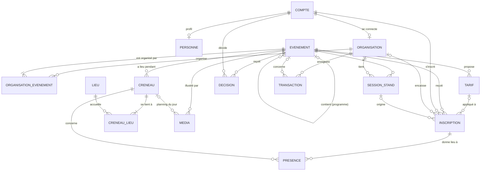

# 06 — Base de données

> SGBD : **PostgreSQL**. Les identifiants sont des `uuid`. Les dates sont en `timestamptz` (fuseau `Africa/Casablanca` à l'affichage).
> Notation MLD : **gras** = clé primaire, `#` = clé étrangère.

---

## 1. MLD

### Comptes et organisations

- **COMPTE** (**id_compte**, email, google_sub, role, statut, date_creation, derniere_connexion, #id_createur → COMPTE)
- **PERSONNE** (**#id_compte**, nom, prenom, photo_url, telephone, niveau, organisme)
- **ORGANISATION** (**id_organisation**, type, nom, sigle, slug, description, logo_url, couverture_url, couleur, email_contact, telephone_contact, instagram, linkedin, statut, date_creation, #id_compte)
- **MEMBRE_ORGANISATION** *(V2)* (**id_membre**, role, annee_universitaire, date_debut, date_fin, #id_compte, #id_organisation)

### Lieux et événements

- **LIEU** (**id_lieu**, code, nom, type, etage, capacite, actif)
- **EVENEMENT** (**id_evenement**, structure, titre, slug, categorie, description_courte, description, affiche_url, couleur, capacite, places_membres, gratuit, ouvert_externes, telephone_requis, mode_inscription, inscriptions_ouvertes, liste_attente_active, statut, date_creation, date_maj, #id_parent → EVENEMENT, #id_createur → COMPTE)
- **TARIF** (**id_tarif**, libelle, prix, affiche, ordre, #id_evenement)
- **ORGANISATION_EVENEMENT** (**#id_evenement, #id_organisation**, role)
- **CRENEAU** (**id_creneau**, debut, fin, libelle, #id_evenement)
- **CRENEAU_LIEU** (**#id_creneau, #id_lieu**, precision)
- **DECISION** (**id_decision**, decision, commentaire, date_decision, #id_evenement, #id_coordinateur → COMPTE)
- **MEDIA** (**id_media**, type, url, texte_alternatif, ordre, #id_evenement, #id_creneau)

### Inscriptions

- **INSCRIPTION** (**id_inscription**, statut, source, token_billet, montant_paye, date_paiement, date_inscription, date_annulation, #id_evenement, #id_compte, #id_tarif → TARIF, #id_organisation_encaisse → ORGANISATION, #id_session_stand → SESSION_STAND, #id_annule_par → COMPTE)
- **SESSION_STAND** (**id_session**, secret, date_ouverture, date_expiration, actif, #id_evenement, #id_organisation, #id_ouvreur → COMPTE)
- **PRESENCE** (**#id_inscription, #id_creneau**, date_checkin, #id_scanneur → COMPTE)

### Trésorerie (V2, en place)

- **TRANSACTION** (**id_transaction**, type, montant, libelle, categorie, date_operation, justificatif_id, date_saisie, #id_organisation, #id_evenement, #id_saisi_par → COMPTE)

### Tables ultérieures

- *(V2, en place)* **SUIVI_ORGANISATION** (**#id_compte, #id_organisation**, notifications_actives, date_suivi)
- *(V2)* **NOTIFICATION** (**id_notification**, type, titre, message, lien, lu, date_creation, #id_compte)
- *(V2, en place)* **ANNONCE** (**id_annonce**, titre, contenu, cible, destinataires, date_publication, #id_evenement, #id_organisation, #id_auteur)
- *(V2)* **PERIODE_BLOQUEE** (**id_periode**, libelle, debut, fin, motif, #id_createur → COMPTE)
- *(V3)* **FEEDBACK** (**#id_inscription**, note, commentaire, date_feedback)

> Retirés du périmètre : recrutement (`CAMPAGNE_RECRUTEMENT`, `CANDIDATURE_ORGANISATION`) et filières (`FILIERE`).

---

## 2. Diagramme entité-association (V1 + trésorerie)



---

## 3. Types énumérés

| Enum | Valeurs |
| --- | --- |
| `role_compte` | `ETUDIANT`, `EXTERNE`, `ORGANISATION`, `COORDINATEUR`, `ADMIN` |
| `statut_compte` | `ACTIF`, `SUSPENDU` |
| `type_organisation` | `CLUB`, `ASSOCIATION` |
| `statut_organisation` | `ACTIVE`, `INACTIVE` |
| `type_lieu` | `SALLE`, `AMPHI`, `SALLE_LECTURE`, `ECOLE_ENTIERE`, `AUTRE` |
| `structure_evenement` | `SIMPLE`, `PROGRAMME`, `SOUS_EVENEMENT` |
| `categorie_evenement` | `CONFERENCE`, `FORMATION`, `ATELIER`, `COMPETITION`, `CULTUREL`, `SPORTIF`, `SOIREE`, `SORTIE`, `AUTRE` |
| `mode_inscription` | `AUCUNE`, `STAND`, `EN_LIGNE` |
| `statut_evenement` | `BROUILLON`, `EN_ATTENTE`, `MODIF_DEMANDEE`, `VALIDE`, `REFUSE`, `PUBLIE`, `ANNULE`, `TERMINE` |
| `role_organisateur` | `PRINCIPAL`, `PARTENAIRE` |
| `type_decision` | `VALIDE`, `REFUSE`, `MODIF_DEMANDEE` |
| `type_media` | `AFFICHE`, `PLANNING`, `PHOTO` |
| `statut_inscription` | `PRE_INSCRITE`, `CONFIRMEE`, `LISTE_ATTENTE`, `ANNULEE` |
| `source_inscription` | `EN_LIGNE`, `STAND`, `MEMBRE` (place membre attribuée par l'organisation) |
| `role_membre` *(V2)* | `PRESIDENT`, `VICE_PRESIDENT`, `SECRETAIRE`, `TRESORIER`, `MEMBRE` |
| `type_transaction` *(V2)* | `RECETTE`, `DEPENSE` |

---

## 4. Dictionnaire de données (V1)

### COMPTE

| Colonne | Type | Contraintes |
| --- | --- | --- |
| id_compte | uuid | PK |
| email | text | NOT NULL, UNIQUE, stocké en minuscules ; doit être une adresse Google |
| google_sub | text | UNIQUE ; identifiant Google, renseigné à la première connexion (NULL = compte créé par le staff, jamais connecté) |
| role | role_compte | NOT NULL |
| statut | statut_compte | NOT NULL, défaut `ACTIF` |
| date_creation | timestamptz | NOT NULL, défaut now() |
| derniere_connexion | timestamptz | |
| id_createur | uuid | FK → COMPTE. **NULL = compte créé automatiquement à la première connexion Google** : `ETUDIANT` si l'email finit par `@etu.uae.ac.ma`, sinon `EXTERNE` (RG-01) |

Aucune colonne de mot de passe : l'authentification est entièrement déléguée à Google.

### PERSONNE

| Colonne | Type | Contraintes |
| --- | --- | --- |
| id_compte | uuid | PK, FK → COMPTE ON DELETE CASCADE |
| nom, prenom | text | NOT NULL ; pré-remplis depuis Google |
| photo_url | text | photo du profil Google |
| telephone | text | demandé seulement quand un événement l'exige (RG-28) ; format marocain vérifié par le service |
| niveau | text | texte libre facultatif (ex. `1A`, `CP2`) ; pas de gestion des filières |
| organisme | text | facultatif, pour les externes (école, entreprise…) |

### ORGANISATION

| Colonne | Type | Contraintes |
| --- | --- | --- |
| id_organisation | uuid | PK |
| type | type_organisation | NOT NULL |
| nom | text | NOT NULL, UNIQUE |
| sigle | text | |
| slug | text | NOT NULL, UNIQUE |
| description | text | |
| logo_url, couverture_url, instagram, linkedin | text | |
| email_contact, telephone_contact | text | affichés sur les billets (demandes d'annulation après paiement) |
| statut | statut_organisation | NOT NULL, défaut `ACTIVE` |
| date_creation | timestamptz | NOT NULL |
| id_compte | uuid | NOT NULL, **UNIQUE**, FK → COMPTE (RG-03) |

### LIEU

| Colonne | Type | Contraintes |
| --- | --- | --- |
| id_lieu | uuid | PK |
| code | text | NOT NULL, UNIQUE (ex. `101`, `AMPHI`) |
| nom | text | NOT NULL |
| type | type_lieu | NOT NULL |
| etage | smallint | |
| capacite | integer | |
| actif | boolean | NOT NULL, défaut true |

### EVENEMENT

| Colonne | Type | Contraintes |
| --- | --- | --- |
| id_evenement | uuid | PK |
| structure | structure_evenement | NOT NULL |
| titre | text | NOT NULL |
| slug | text | NOT NULL, UNIQUE |
| categorie | categorie_evenement | NOT NULL |
| description_courte | text | |
| description | text | |
| affiche_url | text | requis pour publier |
| capacite | integer | NULL = illimitée ; CHECK > 0 |
| places_membres | integer | NOT NULL, défaut 0 ; CHECK (places_membres >= 0 AND (capacite IS NULL OR places_membres <= capacite)) (RG-29) |
| gratuit | boolean | NOT NULL, défaut true ; si false, au moins un `TARIF` affiché est requis pour publier (RG-36) |
| ouvert_externes | boolean | NOT NULL, défaut false (RG-31) |
| telephone_requis | boolean | NOT NULL, défaut false (RG-28) |
| mode_inscription | mode_inscription | NOT NULL ; `AUCUNE` obligatoire si `structure = PROGRAMME` |
| inscriptions_ouvertes | boolean | NOT NULL, défaut false |
| liste_attente_active | boolean | NOT NULL, défaut false ; seulement si `gratuit = true` |
| statut | statut_evenement | NOT NULL, défaut `BROUILLON` |
| date_creation, date_maj | timestamptz | NOT NULL |
| id_parent | uuid | FK → EVENEMENT ; NOT NULL **si et seulement si** `structure = SOUS_EVENEMENT` |
| id_createur | uuid | NOT NULL, FK → COMPTE ; un compte `COORDINATEUR` pour un événement créé par le coordinateur (RG-27) |

Contraintes :

```sql
CHECK ((structure = 'SOUS_EVENEMENT') = (id_parent IS NOT NULL))
CHECK (structure <> 'PROGRAMME' OR mode_inscription = 'AUCUNE')
```

Le parent d'un `SOUS_EVENEMENT` doit être un `PROGRAMME`. Cette règle est vérifiée dans le service (profondeur maximale 1, RG-05).

### ORGANISATION_EVENEMENT

| Colonne | Type | Contraintes |
| --- | --- | --- |
| id_evenement | uuid | PK, FK → EVENEMENT ON DELETE CASCADE |
| id_organisation | uuid | PK, FK → ORGANISATION |
| role | role_organisateur | NOT NULL |

Une seule organisation principale par événement :

```sql
CREATE UNIQUE INDEX un_principal_par_evenement
  ON organisation_evenement (id_evenement) WHERE role = 'PRINCIPAL';
```

Les sous-événements héritent des organisateurs du programme parent : pas de ligne propre en V1.

### CRENEAU

| Colonne | Type | Contraintes |
| --- | --- | --- |
| id_creneau | uuid | PK |
| debut | timestamptz | NOT NULL |
| fin | timestamptz | NOT NULL, CHECK (fin > debut) |
| libelle | text | ex. « Jour 1 — Ouverture » |
| id_evenement | uuid | NOT NULL, FK → EVENEMENT ON DELETE CASCADE |

`debut` et `fin` sont des horodatages, ce qui permet à une soirée de dépasser minuit. Un événement `PROGRAMME` n'a pas de créneau propre : ses dates sont calculées à partir de ses sous-événements.

### CRENEAU_LIEU

| Colonne | Type | Contraintes |
| --- | --- | --- |
| id_creneau | uuid | PK, FK → CRENEAU ON DELETE CASCADE |
| id_lieu | uuid | PK, FK → LIEU |
| precision | text | obligatoire si le lieu est de type `AUTRE` (service) |

### DECISION

| Colonne | Type | Contraintes |
| --- | --- | --- |
| id_decision | uuid | PK |
| decision | type_decision | NOT NULL |
| commentaire | text | CHECK (decision = 'VALIDE' OR commentaire IS NOT NULL) |
| date_decision | timestamptz | NOT NULL |
| id_evenement | uuid | NOT NULL, FK → EVENEMENT |
| id_coordinateur | uuid | NOT NULL, FK → COMPTE |

Un événement créé par le coordinateur reçoit automatiquement une décision `VALIDE` avec le commentaire « Créé par le coordinateur » (RG-27).

### MEDIA

| Colonne | Type | Contraintes |
| --- | --- | --- |
| id_media | uuid | PK |
| type | type_media | NOT NULL |
| url | text | NOT NULL |
| texte_alternatif | text | |
| ordre | smallint | NOT NULL, défaut 0 |
| id_evenement | uuid | NOT NULL, FK → EVENEMENT ON DELETE CASCADE |
| id_creneau | uuid | FK → CRENEAU ; renseigné pour le planning d'un jour précis |

### INSCRIPTION

| Colonne | Type | Contraintes |
| --- | --- | --- |
| id_inscription | uuid | PK |
| statut | statut_inscription | NOT NULL |
| source | source_inscription | NOT NULL |
| token_billet | text | NOT NULL, UNIQUE (32 octets aléatoires, base64url) |
| montant_paye | numeric(8,2) | |
| date_paiement | timestamptz | |
| date_inscription | timestamptz | NOT NULL ; sert aussi d'ordre de la liste d'attente |
| date_annulation | timestamptz | |
| id_evenement | uuid | NOT NULL, FK → EVENEMENT ; jamais un `PROGRAMME` (service) |
| id_compte | uuid | NOT NULL, FK → COMPTE |
| id_organisation_encaisse | uuid | FK → ORGANISATION (RG-18) |
| id_tarif | uuid | FK → TARIF ; choisi par l'organisation au moment de l'encaissement (RG-32), NULL avant |
| id_session_stand | uuid | FK → SESSION_STAND ; renseigné si source = `STAND` |
| id_annule_par | uuid | FK → COMPTE ; qui a annulé (l'étudiant, ou l'organisation pour une inscription payée, RG-17) |

Contraintes :

```sql
UNIQUE (id_evenement, id_compte)                                   -- RG-16
CHECK ((date_paiement IS NULL) = (montant_paye IS NULL)
   AND (date_paiement IS NULL) = (id_organisation_encaisse IS NULL))
CHECK (source <> 'MEMBRE' OR (statut IN ('CONFIRMEE','ANNULEE') AND date_paiement IS NULL))
```

- Une inscription est **payée** si `date_paiement IS NOT NULL`. Dans ce cas, seule l'organisation qui a encaissé peut l'annuler (RG-17).
- Les inscriptions `source = MEMBRE` consomment le quota `places_membres` ; toutes les autres consomment les places publiques.
- Si un étudiant se réinscrit après une annulation, on réactive la ligne existante au lieu d'en créer une nouvelle.
- Événement gratuit : `CONFIRMEE` (ou `LISTE_ATTENTE`) directement. Événement payant : `PRE_INSCRITE`, puis `CONFIRMEE` quand l'organisation choisit un tarif et encaisse (`montant_paye` = prix du tarif, 0 possible).

### TARIF

| Colonne | Type | Contraintes |
| --- | --- | --- |
| id_tarif | uuid | PK |
| libelle | text | NOT NULL, ex. « Adhérent », « Non-adhérent », « Externe », « Bureau » |
| prix | numeric(8,2) | NOT NULL, CHECK ≥ 0 |
| affiche | boolean | NOT NULL, défaut true ; false = tarif spécial visible uniquement par les organisateurs |
| ordre | smallint | NOT NULL, défaut 0 |
| id_evenement | uuid | NOT NULL, FK → EVENEMENT ON DELETE CASCADE |

`UNIQUE (id_evenement, libelle)`. Un tarif déjà utilisé par une inscription payée ne peut pas être supprimé (seulement masqué). L'API publique ne renvoie jamais les tarifs où `affiche = false`.

### SESSION_STAND

| Colonne | Type | Contraintes |
| --- | --- | --- |
| id_session | uuid | PK |
| secret | text | NOT NULL (32 octets aléatoires en base64url) ; **jamais renvoyé au client** |
| date_ouverture | timestamptz | NOT NULL |
| date_expiration | timestamptz | NOT NULL (par défaut, ouverture + 8 h) |
| actif | boolean | NOT NULL |
| id_evenement | uuid | NOT NULL, FK → EVENEMENT |
| id_organisation | uuid | NOT NULL, FK → ORGANISATION (organisation qui tient le stand) |
| id_ouvreur | uuid | NOT NULL, FK → COMPTE |

### PRESENCE

| Colonne | Type | Contraintes |
| --- | --- | --- |
| id_inscription | uuid | PK, FK → INSCRIPTION |
| id_creneau | uuid | PK, FK → CRENEAU (RG-19 : une présence par créneau) |
| date_checkin | timestamptz | NOT NULL |
| id_scanneur | uuid | NOT NULL, FK → COMPTE |

### TRANSACTION (V2)

| Colonne | Type | Contraintes |
| --- | --- | --- |
| id_transaction | uuid | PK |
| type | type_transaction | NOT NULL |
| montant | numeric(10,2) | NOT NULL, CHECK > 0 |
| libelle | text | NOT NULL |
| categorie | text | ex. matériel, impression, transport, billetterie |
| date_operation | date | NOT NULL |
| justificatif_id | text | identifiant Cloudinary `authenticated` (jamais une URL publique) |
| date_saisie | timestamptz | NOT NULL |
| id_organisation | uuid | NOT NULL, FK → ORGANISATION |
| id_evenement | uuid | FK → EVENEMENT |
| id_saisi_par | uuid | NOT NULL, FK → COMPTE |

---

## 5. Index

```sql
CREATE INDEX ON evenement (statut);
CREATE INDEX ON evenement (id_parent);
CREATE INDEX ON creneau (id_evenement, debut);
CREATE INDEX ON creneau (debut);                       -- calendrier coordinateur
CREATE INDEX ON inscription (id_evenement, statut);
CREATE INDEX ON inscription (id_compte);
CREATE INDEX ON tarif (id_evenement);
CREATE INDEX ON organisation_evenement (id_organisation);
CREATE INDEX ON transaction (id_organisation, date_operation);   -- V2
```

---

## 6. Requêtes de référence

**Places restantes** (RG-29) :

```sql
SELECT e.capacite - e.places_membres
       - count(i.*) FILTER (WHERE i.statut = 'CONFIRMEE' AND i.source <> 'MEMBRE') AS publiques_restantes,
       e.places_membres
       - count(i.*) FILTER (WHERE i.statut = 'CONFIRMEE' AND i.source = 'MEMBRE')  AS membres_non_attribuees
FROM evenement e LEFT JOIN inscription i USING (id_evenement)
WHERE e.id_evenement = $1 GROUP BY e.capacite, e.places_membres;
```

**Section « Le même jour »** pour le coordinateur (RG-10) :

```sql
SELECT DISTINCT e.id_evenement, e.titre, c.debut, c.fin, l.nom AS lieu
FROM creneau c
JOIN evenement e USING (id_evenement)
JOIN creneau_lieu cl USING (id_creneau)
JOIN lieu l USING (id_lieu)
WHERE e.statut IN ('VALIDE', 'PUBLIE')
  AND c.debut::date IN (SELECT debut::date FROM creneau WHERE id_evenement = ANY($1))
  AND e.id_evenement <> ALL($1);
```

`$1` contient l'événement demandé et, pour un programme, ses sous-événements.

---

## 7. Données initiales (seed)

**Lieux :**

| code | nom | type | étage |
| --- | --- | --- | --- |
| 001 … 006 | Salle 001 … Salle 006 | SALLE | 0 |
| 101 … 106 | Salle 101 … Salle 106 | SALLE | 1 |
| 201 … 206 | Salle 201 … Salle 206 | SALLE | 2 |
| AMPHI | Amphithéâtre | AMPHI | |
| LECTURE | Salle de lecture | SALLE_LECTURE | |
| ECOLE | Toute l'école | ECOLE_ENTIERE | |
| AUTRE | Autre lieu (préciser) | AUTRE | |

**Comptes :** un compte `ADMIN` initial (adresse Google) lu dans une variable d'environnement au premier déploiement ; il s'active à sa première connexion Google.
